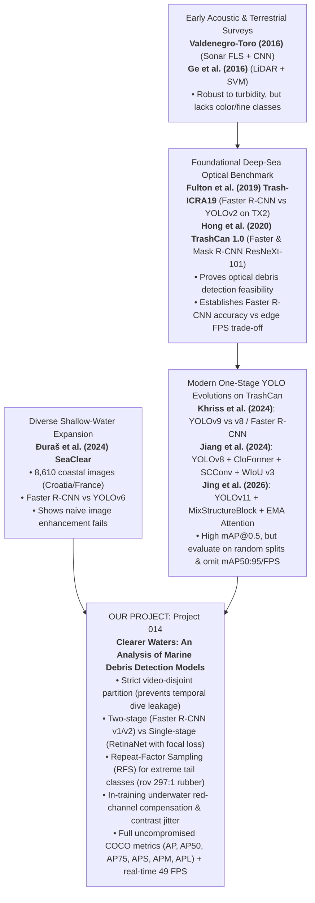

# COMP9444 Project 014: Marine Debris Detection — Comprehensive Literature Review & Benchmark Reference

> **Project Title:** Clearer Waters: An Analysis of Marine Debris Detection Models  
> **Target Dataset:** TrashCan 1.0 (JAMSTEC J-EDI ROV Imagery, Material & Instance Splits)  
> **Core Focus:** Automated visual detection of submerged marine debris using deep neural architectures, comparing one-stage vs. two-stage detectors, underwater visual augmentations, and edge deployment feasibility.

---

## 1. Comparative Executive Matrix

| Metric / Dimension | **Valdenegro-Toro (2016)** | **Ge et al. (2016)** | **Fulton et al. (2019)** | **[Foundational] Hong et al. (2020)** | **Khriss et al. (2024)** | **Jiang et al. (2024)** | **Đuraš et al. (2024)** | **Jing et al. (2026)** |
| :--- | :--- | :--- | :--- | :--- | :--- | :--- | :--- | :--- |
| **Title** | *Submerged Marine Debris Detection with AUVs* | *Semi-automatic Recognition of Marine Debris on Beaches* | *Robotic Detection of Marine Litter Using Deep Visual Detection Models* | *TrashCan: A Semantically-Segmented Dataset Towards Visual Detection of Marine Debris* | *Comparative Study on Marine Object Detection Using YOLOv9* | *Research on the Identification and Classification of Marine Debris Based on Improved YOLOv8* | *A Dataset for Detection and Segmentation of Underwater Marine Debris in Shallow Waters* | *An Improved YOLOv11 Network for Marine Debris Detection in Underwater Environment* |
| **Venue** | IEEE RAHA 2016 | Nature *Scientific Reports* 2016 | IEEE ICRA 2019 (arXiv:1804.01079) | arXiv:2007.08097 / ICRA 2020 | *J. Ecological Engineering* 2024 | Marine Science & Eng. 2024 | Applied Sciences 2024 (SeaClear) | Nature *Scientific Reports* 2026 |
| **Sensing Modality** | 2D Forward-Looking Sonar (FLS ARIS 3000) | Full-waveform Terrestrial LiDAR (RIEGL VZ-4000) | Optical RGB Camera (Deep-sea ROV) | Optical RGB Camera (Deep-sea ROV) | Optical RGB Camera (ROV & Field) | Optical RGB Camera (Deep-sea ROV) | Optical RGB Camera (Shallow coastal ROV) | Optical RGB Camera (Deep-sea ROV) |
| **Operating Domain** | Water tank / acoustic seafloor | Intertidal shoreline / beach | Submerged deep sea (JAMSTEC J-EDI) | Submerged deep sea (JAMSTEC J-EDI) | Submerged sea & open water | Submerged deep sea (TrashCan) | Shallow coastal waters (Croatia & France) | Submerged deep sea (TrashCan) |
| **Model / Algorithm** | Sliding-window CNN (learned acoustic features) | LiDAR waveform features + SVM | Faster R-CNN (Inception v2), YOLOv2, Tiny-YOLO, SSD MobileNet v2 | Faster R-CNN & Mask R-CNN (ResNeXt-101-FPN) | YOLOv9 (GELAN + PGI) vs YOLOv8, Faster R-CNN, SSD | YOLOv8 + CloFormer + C2f-SCConv + WIoU v3 | Faster R-CNN (ResNet-50) vs YOLOv6 | YOLOv11 + MixStructureBlock + EMA Attention |
| **Target Classes** | 10 debris classes (bottles, cans, tires, chains) | 4 material classes (plastic, paper, cloth, metal) | 3 broad classes: Plastic, ROV, Bio | Material (16 classes) & Instance (22 classes) | Marine debris & benthic objects | Instance (22 classes) & Material (16 classes) | 34 merged categories (debris, organisms, robot) | Instance (22 classes) & Material (16 classes) |
| **Dataset Size** | 2,069 acoustic frames | 87 placed items (96M LiDAR points) | Trash-ICRA19: 5,720 train / 820 test images | TrashCan: 7,212 images (6,065 train / 1,147 val) | TrashCan & DeepTrash datasets | TrashCan: 7,212 images (6,065 train / 1,147 val) | SeaClear: 8,610 images across 5 locations | TrashCan: 7,212 images (6,065 train / 1,147 val) |
| **Reported Results** | ~80% detection accuracy | 82.8% target detection; 75.4% mean field accuracy | Faster R-CNN: **81.0 mAP** (5.66 FPS TX2); Tiny-YOLO: **31.6 mAP** (20.5 FPS TX2); YOLOv2: **47.9 mAP** | Instance: **34.5 AP / 55.4 AP50** Material: **29.1 AP / 51.2 AP50** | YOLOv9 achieved highest mAP & recall, smooth training curves | Instance: **+5.7% mAP@0.5, +6.0% F1** Material: **+5.5% mAP@0.5, +5.0% F1** | YOLOv6 outperformed Faster R-CNN by **~7%**; colour enhancement failed | Instance: **81.54% mAP@0.5** Material: **82.75% mAP@0.5** |
| **Edge Hardware Benchmarked** | Not evaluated on embedded board | Stationary terrestrial tripod | **Jetson TX2 (15W)**, GTX 1080 GPU, Laptop CPU | Server GPU (~15–20 FPS) | Server GPU | Not reported | Embedded edge suitable (YOLOv6) | Not reported (Weight footprint: 5.20 MB) |
| **Key Strengths** | Invariant to zero-visibility turbidity and darkness | 115 m range; invariant to ambient sunlight; 3D profiles | Authentic deep-sea footage; rigorous edge hardware speed benchmark (TX2); 10-year video gap | Public pixel masks and boxes; standardized COCO AP evaluation; benchmark foundation | GELAN gradient paths and PGI training stability | Multi-scale local-global features (CloFormer); noise suppression (SCConv); dynamic loss (WIoU) | Multi-site shallow coastal diversity; realistic variable water clarity; dual box/mask | Massive mAP@0.5 gain over baseline YOLO; lightweight footprint (5.2 MB) |
| **Core Limitations** | Tank testing; no color/texture; cannot classify material | Terrestrial only; complete failure on glass (SiO₂ overlap); manual features | Broad 3-class grouping; single-stage models failed on `Bio`; older detectors (YOLOv2) | Frame-level train/val leakage; severe class imbalance; heavy red attenuation | Struggles on rare benthic items; random frame split; no video-disjoint isolation | Evaluated only with mAP@0.5; omitted FPS; random frame split; box only | Cross-domain performance drop on unseen locations; naive image enhancement failed | Evaluated only with mAP@0.5; omitted FPS; no held-out test split; no two-stage comparison |

## 2. Paper 1: Valdenegro-Toro (2016)

### Citation & Metadata
- **Full Title:** Submerged Marine Debris Detection with Autonomous Underwater Vehicles
- **Author:** Matias Valdenegro-Toro
- **Publication:** *2016 International Conference on Robotics and Automation for Humanitarian Applications (RAHA)*, IEEE, pp. 1–7, Dec 2016.
- **Related Subsequent Work:** 
  - PhD Thesis: *Deep Learning for Autonomous Underwater Vehicles: Marine Debris Detection and Localization*, Heriot-Watt University, 2019.
  - Preprint: *Deep Neural Networks for Marine Debris Detection in Sonar Images*, arXiv:1905.05241 (May 2019).
  - Extended Benchmark: *The Marine Debris Forward-Looking Sonar Datasets*, IEEE OCEANS Brest 2025.

### What the Paper Was About
Underwater robots (AUVs) navigating the seabed for debris mitigation face catastrophic visual degradation: optical cameras lose light absorption exponentially with depth, while suspended particulate matter causes severe backscatter and turbidity. Valdenegro-Toro investigated replacing optical cameras with **Forward-Looking Sonar (FLS)** and training deep convolutional neural networks (CNNs) directly on acoustic echograms to autonomously classify and locate debris items resting on the seafloor.

### Methodology
1. **Sensor Setup:** An **ARIS Explorer 3000** dual-frequency Forward-Looking Sonar sensor was deployed to emit high-frequency acoustic pulses and reconstruct 2D Cartesian acoustic intensity frames from returning echoes.
2. **Deep Learning Pipeline:** Rather than relying on hand-crafted sonar descriptors (e.g., Haar cascades or image moments), a CNN was trained end-to-end to learn spatial acoustic texture patterns and acoustic shadow contours cast by debris objects.
3. **Localization:** Deployed a sliding-window bounding box proposer across the sonar beam swath to detect items across multiple ranges.

### Key Benefits & Findings
- **Acoustic Penetration:** Sonar is physically invariant to water turbidity, total darkness, and suspended silt, maintaining detection capability where optical sensors produce complete blackness or severe backscatter.
- **Automated Feature Extraction:** Demonstrated that CNNs can autonomously extract discriminative acoustic reflection profiles without manual feature engineering.
- **Feasibility Benchmark:** Achieved approximately **80% detection accuracy** in initial trials, proving the viability of autonomous robotic sonar debris surveys without human diver intervention.

### Dataset Used
- **Experimental Test Tank:** Collected in a controlled freshwater research wave tank at Heriot-Watt University. Common marine debris articles (glass bottles, metal beverage cans, rubber tires, plastic jugs, mooring chains) and distractor objects were placed along the bottom.
- **Subsequent Dataset Growth:** While the 2016 conference paper evaluated a smaller private proof-of-concept capture, the author's 2019 thesis and arXiv:1905.05241 paper expanded this into a benchmark of **2,069 sonar frames** (10 target object classes + background).

### Critical Limitations
1. **Controlled Environment Bias:** All data was captured in an enclosed testing tank with flat concrete bottoms and no marine vegetation, heavy tidal currents, or suspended organic marine snow. Real seabed topography introduces heavy reverberation and clutter.
2. **Closed / Private Dataset:** The original 2016 dataset was not initially open-sourced, preventing direct community reproduction (though later sonar datasets were released in 2021–2025).
3. **Lack of Chromatic and High-Resolution Detail:** Acoustic echograms provide no color information and significantly lower spatial resolution than optical cameras. Discerning material categories (e.g., differentiating plastic polymers from aluminum or painted metal) based purely on acoustic reflection is inherently ambiguous.
4. **Computational Inefficiency:** The sliding-window classifier approach incurs high inference latency compared to modern single-shot or anchor-based detectors.

### Takeaway for COMP9444 Project 014
> **Direct Project Relevance:** Valdenegro-Toro illustrates the physical trade-off between sonar (high penetration, zero optical color) and optical cameras (rich color/texture, but vulnerable to turbidity). Our project deliberately operates on optical camera imagery (TrashCan) because distinguishing fine material types (plastic, metal, paper, wood) requires rich color spectra and high-frequency surface texture that sonar cannot provide.  
> *Note for Final Report:* Check the original 2016 paper via the UNSW Library to cross-verify the specific 80% accuracy calculation and tank dimensions before final thesis submission.

---

## 3. Paper 2: Ge et al. (2016)

### Citation & Metadata
- **Full Title:** Semi-automatic Recognition of Marine Debris on Beaches
- **Authors:** Zhenpeng Ge, Huahong Shi, Xuefei Mei, Zhijun Dai, and Daoji Li
- **Publication:** *Scientific Reports* (Springer Nature), Vol. 6, Article 25759, May 2016. DOI: [10.1038/srep25759](https://doi.org/10.1038/srep25759).

### What the Paper Was About
Manual beach debris surveys (e.g., transect walks mandated by NOAA/OSPAR) are labor-intensive, logistically slow, subjective, and unable to capture dense spatial geometry. Previous automated attempts using stationary coastal webcams suffered from major flaws: they could only track brightly colored macro-plastics and failed completely at night, in fog, or when plastics were sun-bleached. Ge et al. proposed using **terrestrial full-waveform Light Detection and Ranging (LiDAR)** to autonomously detect, classify by material, and reconstruct 3D geometric models of beach debris over wide areas.

### Methodology
1. **LiDAR Hardware:** A **RIEGL VZ-4000** terrestrial long-range laser scanner was mounted on a tripod surveying platform.
2. **Waveform Feature Extraction:** For every laser backscatter pulse, the scanner recorded the full returning waveform. After filtering out ground sand points using height thresholding, three discriminative echo features were computed for each target point:
   - **Echo Amplitude** (reflected signal strength)
   - **Echo Width** (pulse stretching caused by surface roughness/depth)
   - **Echo Order** (sequence index of the returning pulse)
3. **Classification & 3D Reconstruction:**
   - A **Support Vector Machine (SVM)** classified individual point returns into five target classes: *Plastic*, *Paper*, *Cloth*, *Metal*, and *Ground*.
   - Adjacent classified points were clustered into discrete debris entities and meshed into reconstructed 3D computer models.

### Key Benefits & Findings
- **High Detection Rate:** In controlled trials, the system detected **72 out of 87 predetermined debris items (82.8% detection rate)**.
- **Survey Speed:** A full beach scan took **~20 minutes**, compared to approximately **3 hours** required for a traditional manual human transect survey over the same area.
- **Superior Sensitivity:** In field validation surveys, LiDAR detected significantly more total items than human observers for all material categories except glass.
- **Physical Metrics & Long Range:** Unlike 2D cameras, LiDAR provided exact metric physical dimensions, volume estimates, and true 3D spatial coordinates. It successfully identified an **8.5 cm plastic bottle at a distance of 115 meters**.
- **Illumination Invariance:** Because LiDAR is an active emitter (near-infrared laser), it operates in broad daylight, twilight, or total darkness without performance degradation.

### Dataset Used
- **Controlled Benchmark (Nanhui Beach, Shanghai):** Conducted on 1 January 2015 across a 54,000 m² sandy area. 87 pre-cataloged debris items were distributed ~100 m from the scanner, generating ~96 million point returns.
- **Field Validation (Beihai Beach, Guangxi):** Three separate in-situ field validation cruise surveys along a 150 m × 50 m natural coastal shoreline, directly compared against manual human survey counts.

### Critical Limitations
1. **Total Glass Failure:** Glass items were never detected (0% recall). Sand and glass share the same primary chemical compound ($\text{SiO}_2$), resulting in virtually identical laser backscatter amplitude and pulse width.
2. **Point Cloud Dilution with Distance:** Laser beam angular divergence causes point density to decay quadratically with distance. Objects beyond 100 m received fewer laser strikes, leading to missed small debris and coarse, blocky 3D surface reconstructions.
3. **Stationary Tripod Footprint:** Fixed tripod placement restricts line-of-sight and creates occlusion shadows behind coastal dunes and larger rocks. Mounting on mobile platforms was suggested but not implemented.
4. **Terrestrial-Only Modality:** Near-infrared LiDAR suffers rapid absorption in water; it is physically impossible to deploy this laser configuration for underwater seafloor debris surveying.
5. **Hand-Crafted Features & Shallow Classifier:** Relies on manual feature engineering and a basic SVM with only four material classes.
6. **Ambiguous Metric Derivation:** The paper reports a "mean accuracy of 75.4%" across field trials without explicitly documenting the mathematical formula or confusion matrix used to derive this aggregate figure.

### Takeaway for COMP9444 Project 014
> **Direct Project Relevance:** Demonstrates the value of multi-material classification (plastic vs. metal vs. cloth) and automated surveying. However, LiDAR's inability to penetrate water and complete blindness to glass highlights why our project turns to passive optical RGB imaging with deep convolutional networks—allowing our models to detect glass, rubber, and organic objects underwater based on semantic visual context.

---

## 4. Foundational Robotic Detection on JAMSTEC: Fulton et al. (2019)

### Citation & Metadata
- **Full Title:** Robotic Detection of Marine Litter Using Deep Visual Detection Models
- **Authors:** Matthew Fulton, Jungseok Hong, Md Jahidul Islam, and Junaed Sattar
- **Publication:** *2019 IEEE International Conference on Robotics and Automation (ICRA)*, Montreal, Canada, pp. 5752–5758, May 2019. doi:10.1109/ICRA.2019.8793975. arXiv:1804.01079.
- **Laboratory:** Interactive Robotics and Vision Laboratory (IRVLab), Department of Computer Science and Engineering, University of Minnesota.

### What the Paper Was About
Prior to this study, underwater marine debris detection was largely evaluated on synthetic images or small water tank experiments. Fulton et al. investigated whether state-of-the-art deep convolutional object detection models could accurately spot marine litter in authentic, unconstrained deep-sea robotic video footage—and whether these architectures could run fast enough on power-constrained embedded mobile hardware to enable real-time visual servoing and autonomous trash collection by Autonomous Underwater Vehicles (AUVs).

### Methodology
1. **Model Architectures Benchmarked:**
   - **Two-Stage Detector:** Faster R-CNN with Inception v2 backbone.
   - **Dense Single-Stage Detector:** SSD (Single Shot MultiBox Detector) with MobileNet v2 backbone.
   - **Grid Single-Stage Detector:** YOLOv2 (full-capacity architecture).
   - **Lightweight Single-Stage Detector:** Tiny-YOLO (pruned, low-latency variant).
2. **Multi-Tier Hardware Speed Evaluation:**
   To directly assess edge deployment feasibility on robotic platforms, inference latency was benchmarked across three hardware setups:
   - High-end desktop workstation GPU (NVIDIA GeForce GTX 1080)
   - Embedded mobile computing board suitable for AUV payloads (**NVIDIA Jetson TX2**, consuming ~15W)
   - Standard laptop CPU
3. **Evaluation Protocol:** Models were assessed using standard Intersection over Union (IoU) and mean Average Precision (mAP), alongside frame rate (Frames Per Second, FPS).

### Key Benefits & Findings
- **First Real-World Deep-Sea Benchmark:** Evaluated on real deep-sea ROV footage across varied sea basins, seafloor terrains, and illumination levels.
- **Accuracy vs. Latency Pareto Frontier on Jetson TX2:**
  - **Faster R-CNN** achieved the highest overall detection accuracy (**81.0 mAP**), but was severely compute-bound on the Jetson TX2, reaching only **5.66 FPS** (insufficient for high-speed robotic maneuvering).
  - **Tiny-YOLO** achieved the fastest embedded runtime on the Jetson TX2 (**20.5 FPS** at 15W), but suffered the poorest detection accuracy (**31.6 mAP**).
  - **YOLOv2** balanced performance (**47.9 mAP**, 74 FPS on desktop GPU, but dropped to 7.6 FPS on the TX2).
  - **SSD MobileNet v2** achieved **44.5 mAP** and proved to be the fastest architecture on plain CPU.
- **High Plastic Detection Reliability:** Across all four architectures, detection of the primary target of interest—`Plastic`—was robust, ranging between **69.8 and 83.3 AP**, demonstrating that deep models can consistently identify synthetic polymers amidst benthic debris.
- **Robotic Deployment Feasibility:** Proved that embedded neural inference on low-power boards (15W) is feasible for marine robots, providing the architectural foundation for subsequent autonomous collection systems.

### Dataset Used
- **Trash-ICRA19:** Sourced from the Japan Agency for Marine-Earth Science and Technology (JAMSTEC) J-EDI deep-sea video archive (2000–2017).
- Sampled ~240,000 video frames at 3 fps and hand-annotated **5,720 training images** and **820 test images** at 480×320 resolution.
- **Taxonomy:** 3 broad categories:
  - `Plastic`: Synthetic debris items (bottles, bags, cups, netting).
  - `ROV`: Man-made robotic equipment (manipulator arms, cables, thrusters).
  - `Bio`: Natural benthic organisms and plants (fish, crabs, eels, coral).
- **Temporal Domain Shift:** Crucially, test set images were drawn from videos recorded 10 or more years prior to the training videos, providing a rigorous test of domain generalization across camera sensors and lighting.

### Critical Limitations
1. **Coarse 3-Class Taxonomy:** The authors attempted fine-grained subclassification of plastic into specific litter types, but discarded it due to steep drops in precision; the model cannot distinguish plastic bottles from plastic bags or determine material types.
2. **Single-Stage Failure on Natural Marine Life (`Bio`):** Single-stage detectors failed dramatically on the natural `Bio` class (AP of 4.2 for SSD, 5.2 for Tiny-YOLO, and 9.5 for YOLOv2), whereas Faster R-CNN achieved **73.2 AP**, highlighting that dense single-stage anchor grids struggle with diverse organic contours.
3. **Single Video Archive:** All data derived from JAMSTEC J-EDI; models were not tested on shallow coastal waters or independent ocean basins.
4. **Bounding Box Only:** Output restricted to rectangular bounding boxes; lacked instance segmentation masks for grasp planning.
5. **Dated Baselines:** Evaluated earlier architectures (YOLOv2, SSD, Inception v2) prior to Feature Pyramid Networks (FPN), focal loss, and transformer attention.

### Takeaway for COMP9444 Project 014
> **Direct Project Relevance:** Fulton et al. (2019) is the direct predecessor to TrashCan from the exact same laboratory. It provides the historical justification for our investigation: confirming that Faster R-CNN provides superior feature discriminability over single-stage models in underwater scenes, while highlighting the need for modern architectures (Faster R-CNN ResNet-50-FPN v2 at 49 FPS) that bridge the historical speed-accuracy gap on embedded hardware.

## 5. Foundational Baseline Context: Baseline Context: Hong et al. (2020) — The TrashCan Benchmark

### Citation & Metadata
- **Full Title:** TrashCan: A Semantically-Segmented Dataset Towards Visual Detection of Marine Debris
- **Authors:** Jungseok Hong, Michael Fulton, and Junaed Sattar (University of Minnesota)
- **Publication:** arXiv:2007.08097, July 2020 (presented at IEEE/RSJ IROS / ICRA workshops).

### Dataset Foundation & Overview
TrashCan 1.0 is the benchmark dataset utilized in our COMP9444 project:
- **Imagery Origin:** Sourced from the **J-EDI** (JAMSTEC E-Library of Deep-sea Images) database, recorded by research ROVs operated by the Japan Agency for Marine-Earth Science and Technology since 1982 (primarily in the Sea of Japan and Western Pacific).
- **Dataset Scale:** 7,212 annotated underwater images (1,500+ annotation hours across 21 annotators using Supervisely) partitioned into **6,065 training** and **1,147 validation** images.
- **Two Semantic Configurations:**
  1. **TrashCan-Instance (22 classes):** Fine-grained functional instance labels (`bottle`, `can`, `cup`, `plastic_bag`, `net`, `rope`, `tarp`, `pipe`, `cellphone`, etc.).
  2. **TrashCan-Material (16 classes):** Material-level groupings (`trash_plastic`, `trash_metal`, `trash_paper`, `trash_rubber`, `trash_cloth`, `trash_wood`, `trash_glass`, `trash_etc`, etc.).
- **Annotation Format:** Standard COCO JSON containing both bounding boxes and polygon instance segmentation masks.

### Official Baseline Performance (Hong et al., 2020)

| Task | Detector & Backbone | Split | $AP$ (COCO) | $AP_{50}$ | $AP_{75}$ |
| :--- | :--- | :--- | :--- | :--- | :--- |
| **Object Detection** | Faster R-CNN (ResNeXt-101-FPN) | **TrashCan-Instance** | **34.5** | **55.4** | 35.8 |
| **Object Detection** | Faster R-CNN (ResNeXt-101-FPN) | **TrashCan-Material** | **28.2** | **45.4** | 29.3 |
| **Instance Segmentation** | Mask R-CNN (ResNeXt-101-FPN) | **TrashCan-Instance** | **27.2** | **43.6** | 27.6 |
| **Instance Segmentation** | Mask R-CNN (ResNeXt-101-FPN) | **TrashCan-Material** | **22.8** | **36.3** | 22.8 |

### Takeaway for COMP9444 Project 014
Hong et al. established that:
1. Detecting by *Instance* scored consistently higher than by *Material* (~6.3 AP points higher on detection) because objects in the same functional class share geometric shapes (e.g. cylindrical bottles), whereas objects in the same material class exhibit wildly disparate shapes.
2. The benchmark scores are evaluated strictly under the **COCO AP metric** (averaged over 10 IoU thresholds from 0.50 to 0.95), which is crucial when comparing against recent one-stage papers like Jing et al. (2026).

---

## 6. SOTA Detection Benchmarking: Khriss et al. (2024)

### Citation & Metadata
- **Full Title:** Comparative Study on Marine Object Detection Using YOLOv9 and Other Deep Learning Models
- **Authors:** A. Khriss, K. A. Elmiad, M. Badaoui, and A. Barkaoui
- **Publication:** *Journal of Ecological Engineering*, vol. 25, no. 8, pp. 282–295, 2024. doi:10.12911/22998993/189280.

### What the Paper Was About
Addressed the critical deficit of standardized comparative benchmarking frameworks in marine object detection. Prior studies predominantly evaluated individual models on isolated, private datasets. Khriss et al. conducted an extensive empirical comparison across multiple convolutional architectures (Faster R-CNN, SSD, YOLOv8, and YOLOv9) across varied underwater datasets to identify model stability, precision-recall trade-offs, and failure modes in complex aquatic environments.

### Methodology
1. **Architectures Evaluated:**
   - **YOLOv9:** Leveraging Generalized Efficient Layer Aggregation Network (GELAN) and Programmable Gradient Information (PGI) to retain feature information across deep layer hierarchies.
   - **YOLOv8:** Contemporary single-stage anchor-free baseline.
   - **Faster R-CNN:** Two-stage region proposal baseline.
   - **SSD (Single Shot MultiBox Detector):** Classic single-stage anchor-based baseline.
2. **Datasets Combined:** Evaluated across TrashCan (deep-sea JAMSTEC imagery) and DeepTrash (capturing diverse, turbulent marine environments with severe suspended sediment and variable lighting).
3. **Evaluation Metrics:** Training loss stability curves, Precision, Recall, F1-score, and mean Average Precision (mAP).

### Key Benefits & Findings
- **Superior Training Stability of YOLOv9:** YOLOv9 demonstrated remarkably smooth loss convergence without gradient oscillations, attributed to PGI's auxiliary supervision branch preventing information loss across deep layers.
- **Quantitative Dominance:** YOLOv9 outperformed YOLOv8, Faster R-CNN, and SSD across precision, recall, and mAP, establishing itself as the leading single-stage convolutional architecture for marine debris.
- **Instability of Classical Detectors:** Both Faster R-CNN and SSD exhibited noticeable loss fluctuations during training on underwater datasets, with SSD displaying the lowest training stability.

### Critical Limitations
1. **Failure on Rare and Cluttered Categories:** Despite high overall mAP, YOLOv9 still struggled to detect uncommon, visually ambiguous benthic objects (e.g., submerged shipwrecks, heavily bio-fouled industrial debris) in cluttered marine environments.
2. **Random Split Data Leakage:** Evaluated using standard random frame-level splits, leaving adjacent temporal frames from identical ROV video sequences across train and validation sets.
3. **Omission of Video-Disjoint Generalization:** Did not test model resilience to completely unseen dive sequences or novel camera sensors.

### Takeaway for COMP9444 Project 014
> **Direct Project Relevance:** Khriss et al. confirms that modern single-stage architectures (YOLOv9) dominate standard random-split benchmarks. In our project, we contrast this with a rigorous video-disjoint protocol, evaluating whether modern two-stage detectors with FPN and class-imbalance mitigations (RFS) offer superior generalization when adjacent video frames are strictly withheld.

## 7. Hybrid Attention & Dynamic Loss: Jiang et al. (2024)

### Citation & Metadata
- **Full Title:** Research on the Identification and Classification of Marine Debris Based on Improved YOLOv8
- **Authors:** Y. Jiang et al.
- **Publication:** 2024.

### What the Paper Was About
Underwater debris detection models frequently suffer severe degradation caused by underwater light absorption, low contrast, floating organic particles, and visual camouflage where debris items blend into the surrounding benthic substrate. Jiang et al. focused on redesigning the one-stage YOLOv8 network by introducing hybrid multi-scale attention, redundancy-free feature extraction, and dynamic loss weighting tailored to underwater visual conditions.

### Methodology
1. **CloFormer Hybrid Attention Backbone:**
   Replaced standard convolutional blocks with CloFormer, combining standard convolutions for high-frequency local detail with a shared-weight transformer attention mechanism to extract global context across the entire underwater scene.
2. **C2f-SCConv Redundancy Elimination:**
   Integrated Spatial and Channel Reconstruction Convolution (SCConv) into the C2f feature extraction modules. SCConv splits feature representations into spatial and channel reconstruction units, eliminating redundant feature maps and suppressing background water turbidity noise while reducing computational load.
3. **WIoU v3 Dynamic Bounding Box Loss:**
   Replaced standard CIoU loss with Wise IoU v3. WIoU v3 employs a dynamic, non-monotonic focusing mechanism that assigns gradient weights based on sample outlier degree, preventing low-quality extreme outliers from dominating gradients while focusing learning on medium-quality bounding boxes.

### Key Benefits & Findings
- **Targeted Performance Gains on TrashCan:**
  - **TrashCan-Instance:** Achieved a **+5.7 percentage point increase in mAP@0.5** and a **+6.0 percentage point increase in F1-score** over standard YOLOv8.
  - **TrashCan-Material:** Achieved a **+5.5 percentage point increase in mAP@0.5** and a **+5.0 percentage point increase in F1-score**.
- **Enhanced Benthic Discrimination:** Demonstrated that incorporating global context via CloFormer helps the detector distinguish degraded plastic and metal debris resting on visually similar seafloor sediments.

### Critical Limitations
1. **Small and Occluded Debris Deficit:** The model continued to exhibit high miss rates on small objects ($<32	imes32$ pixels) and debris partially buried beneath sediment or obscured by marine flora.
2. **Increased Architectural Complexity:** Adding CloFormer multi-head attention and SCConv spatial-channel splits increases network depth and memory bandwidth requirements, potentially impacting real-time edge embedded performance.
3. **Evaluation Metric Limitations:** Evaluated exclusively using mAP@0.5 and F1-score; omitted the strict COCO $AP_{50:95}$ average and hardware latency (FPS) benchmarks.
4. **Absence of Video-Disjoint Testing:** Evaluated solely on random frame splits without isolating continuous dive sequences.
5. **Bounding Box Only:** Did not provide instance segmentation masks.

### Takeaway for COMP9444 Project 014
> **Direct Project Relevance:** Validates that attention mechanisms and dynamic loss reweighting provide tangible accuracy boosts on both TrashCan splits. It reinforces our project's approach of combining targeted feature augmentations with class-imbalance loss engineering (RFS and WiSE-FT), while highlighting the necessity of evaluating full COCO AP metrics and true FPS.

## 8. Shallow Coastal Debris Benchmark: Đuraš et al. (2024)

### Citation & Metadata
- **Full Title:** A Dataset for Detection and Segmentation of Underwater Marine Debris in Shallow Waters
- **Authors:** M. Đuraš et al. (SeaClear Consortium)
- **Publication:** *Applied Sciences*, vol. 14, 2024.

### What the Paper Was About
While deep-sea datasets like TrashCan provide deep ocean floor imagery, shallow coastal waters represent the primary zone of human litter entry and marine recreational impact. Shallow waters present unique optical challenges: intense variable natural illumination, surface sunlight caustics/flicker, turbulent suspended sediment, and complex benthic vegetation. Đuraš et al. created the **SeaClear Marine Debris Dataset** to support the EU SeaClear autonomous litter-removal initiative and evaluated the real-world generalization of standard detection baselines across novel dive sites and image enhancement techniques.

### Methodology
1. **Dataset Collection & Diversity:**
   - Deployed ROVs across **five diverse coastal locations in Croatia and France**, capturing 8,610 images under natural daylight, turbid shallow water, and varied seafloor substrates.
   - Annotated with both bounding boxes and polygonal segmentation masks across 40 original categories, reduced to **34 categories** for detection benchmarking by merging classes with fewer than 50 instances.
2. **Architectures Benchmarked:**
   - Two-stage: Faster R-CNN with ResNet-50 backbone (COCO pretrained).
   - Single-stage: YOLOv6 (COCO pretrained), targeted for real-time robotic edge computing.
3. **Underwater Image Enhancement Evaluation:**
   Preprocessed underwater frames with dedicated optical enhancement algorithms (colour balance correction and contrast histogram stretching) to empirically test whether cosmetic visual improvement enhances downstream neural detection accuracy.
4. **Cross-Domain Generalization Testing:**
   Evaluated cross-location and cross-camera domain shifts by testing models on footage recorded at unseen geographic sites.

### Key Benefits & Findings
- **Shallow Coastal Benchmark:** Provides the largest publicly available multi-site dataset for shallow-water marine litter detection and instance segmentation.
- **YOLOv6 Superiority on In-Domain Split:** YOLOv6 achieved approximately **7 percentage points higher detection performance** than Faster R-CNN on the standard in-domain split, offering a fast, compact detector suitable for autonomous robotic deployment.
- **Critical Negative Finding on Image Enhancement:** Applying underwater color and contrast enhancement algorithms **did not consistently improve object detection accuracy**, and frequently degraded performance due to noise amplification and edge distortion in murky frames.
- **Severe Domain Shift Vulnerability:** Model performance experienced steep degradation when tested on unseen cameras or unfamiliar coastal locations, proving that models overfit to specific water clarity and optical profiles.

### Critical Limitations
1. **Geographic Scope:** Restricted to 5 Mediterranean/European coastal sites; does not represent oceanic deep-sea conditions.
2. **Class Imbalance & Category Collapsing:** Severe class imbalance forced the authors to merge low-frequency categories (<50 annotations), reducing classification specificity.
3. **Baseline Architecture Scope:** Evaluated standard off-the-shelf architectures (Faster R-CNN and YOLOv6) without custom underwater architectural adaptations.
4. **Unresolved Cross-Domain Transfer:** Highlighted domain transfer as a major unsolved obstacle without offering an automated domain adaptation solution.

### Takeaway for COMP9444 Project 014
> **Direct Project Relevance:** Đuraš et al. provides crucial complementary evidence for our project. Their finding that naive visual image enhancement fails to improve detector performance directly validates our strategy: rather than relying on external image filters, we apply domain-specific data augmentations (red-channel compensation, contrast jitter) *during training*, allowing the convolutional backbone to learn invariant representations natively while addressing class imbalance via Repeat-Factor Sampling.

## 9. Modern SOTA Attention: Jing et al. (2026)

### Citation & Metadata
- **Full Title:** An Improved YOLOv11 Network for Marine Debris Detection in Underwater Environment
- **Authors:** Yuanwei Jing, Yijiang Ding, Xuemei Wang, and Anis Salwa Mohd Khairuddin
- **Publication:** *Scientific Reports* (Springer Nature), Published February 2026.
- **Open-Source Codebase:** [DavidJing777/yolo-marine](https://github.com/DavidJing777/yolo-marine)

### What the Paper Was About
While two-stage detectors (Faster R-CNN) achieve strong spatial localization, their high parameter count and computational latency pose serious obstacles for deployment on compact, battery-constrained Autonomous Underwater Vehicles (AUVs). Modern one-stage YOLO detectors offer extreme speed, but standard backbones struggle with underwater optical phenomena: severe light attenuation, low contrast, suspended sediment noise, and tiny, heavily occluded debris. Jing et al. redesigned the state-of-the-art **YOLOv11** architecture specifically to enhance multi-scale feature representation and spatial-channel attention while preserving an ultra-compact model size.

### Methodology & Technical Innovations
The authors introduce two architectural modifications to the Ultralytics YOLOv11 framework:

1. **MixStructureBlock (Backbone Multi-Scale Expansion):**
   - **Replaces:** YOLOv11's standard `C3k2` building blocks in the feature extraction backbone.
   - **Mechanism:** Dispatches input feature maps across parallel dilated convolutions with varying kernel sizes (**$3\times3$**, **$5\times5$**, and **$7\times7$**) simultaneously.
   - **Attention Integration:** Combines parallel multi-scale receptive branches with hybrid **channel and pixel attention** before merging.
   - **Target Problem:** Captures fine-grained spatial textures of extremely small debris items and preserves feature cues for partially occluded or deformed marine trash.

2. **Efficient Multi-scale Attention (EMA) Module:**
   - **Replaces:** YOLOv11's default `C2PSA` (Convolutional 2D Position-Sensitive Attention) block.
   - **Mechanism:** Implements grouped spatial-channel feature interaction without channel dimension reduction. It encodes global context via cross-spatial learning branches and aggregates cross-channel interdependencies.
   - **Target Problem:** Suppresses floating marine snow / turbid background noise and enhances object boundary contrast for low-contrast, overlapping targets.

### Training Hyperparameters & Experimental Setup
- **Framework:** Ultralytics YOLOv11 framework (PyTorch).
- **Input Resolution:** $416 \times 416$ pixels (downscaled from raw native dimensions).
- **Optimization:** Trained for **180 epochs** with a batch size of **128**.
- **Hardware:** Single NVIDIA GeForce RTX 3060 (12 GB VRAM).
- **Dataset:** Benchmarked on TrashCan-Instance (primary) and TrashCan-Material (secondary).

### Quantitative Performance & Comparative Benchmarks

#### Overall Detection Benchmark Comparison

| Model | Architecture Type | TrashCan-Instance ($mAP_{50}$) | TrashCan-Material ($mAP_{50}$) | Model Weight Size |
| :--- | :--- | :--- | :--- | :--- |
| **YOLOTrashCan** (Prior specialized baseline) | One-stage YOLOv5-based | 65.01% | 58.66% | ~14.0 MB |
| **TC-YOLO** (Prior marine detector) | One-stage YOLO variant | Reported lower | Reported lower | — |
| **YOLOv8-MU** | One-stage YOLOv8 variant | Reported lower | Reported lower | ~6.5 MB |
| **YOLOv11 (Standard Baseline)** | One-stage Ultralytics | 68.06% | 70.06% | 5.80 MB |
| **Jing et al. (2026) Proposed** | **Improved YOLOv11 (MixStructure + EMA)** | **81.54%** | **82.75%** | **5.20 MB** |

- **Net Improvement on Instance:** **+13.48 percentage points** over standard YOLOv11 ($68.06\% \rightarrow 81.54\%$).
- **Net Improvement on Material:** **+12.69 percentage points** over standard YOLOv11 ($70.06\% \rightarrow 82.75\%$).
- **Model Efficiency:** Model parameter weight footprint is only **5.20 MB**, smaller than plain YOLOv8 and standard YOLOv11.

#### Component Ablation Study (TrashCan-Instance)

| Model Configuration | $mAP_{50}$ (%) | Precision (%) | Recall (%) | Key Impact Observed |
| :--- | :--- | :--- | :--- | :--- |
| **Baseline YOLOv11** | 68.06% | Baseline | Baseline | Standard single-scale receptive field |
| **+ EMA Attention Only** | 78.93% | — | **+12.25 pts** | Dramatic boost in recall (recovers faint/occluded objects) |
| **+ MixStructureBlock Only** | 79.80% | **+5.03 pts** | — | Significant precision boost (reduces false background alarms) |
| **Full Proposed Model (Both)** | **81.54%** | **Optimal** | **Optimal** | Synergistic precision/recall trade-off |

### Critical Limitations & Verification Audit

> [!WARNING]
> **Essential Evaluation Discrepancy (Metric Mismatch):**  
> Jing et al. evaluate exclusively using **$mAP_{50}$** (PASCAL VOC metric at IoU threshold 0.50). In contrast, Hong et al. (2020) and standard COCO benchmarks report **$AP$ ($AP_{50:95}$)**. A score of 81.54% $mAP_{50}$ cannot be directly compared against Hong et al.'s 34.5 COCO AP. When comparing our project's models, we must evaluate both $AP_{50}$ and $AP_{50:95}$ to ensure rigorous parity.

1. **Omission of Strict COCO $mAP_{50:95}$:**  
   As audited in the paper's primary results tables, the authors report only $mAP_{50}$, Precision, Recall, and parameter size. They do **not** report the full COCO $mAP@[0.50:0.95]$ average. High performance at IoU 0.50 does not guarantee tight, accurate bounding box localization at IoU 0.75 or 0.95.
2. **Absence of Empirical Inference Latency (FPS):**  
   Despite pitching the model as a lightweight solution for edge robotics and AUV embedded computing, the paper omits empirical wall-clock inference speed (Frames Per Second / millisecond latency per image) across embedded hardware (e.g. NVIDIA Jetson Orin Nano / Xavier). Model parameter size (5.2 MB) does not always correlate directly with runtime FPS due to kernel launch overheads in multi-branch dilated convolutions.
3. **Narrow Model Comparison (YOLO Island):**  
   Every comparative baseline in the paper is a YOLO variant (YOLOv8, YOLOv11, YOLOTrashCan, TC-YOLO, YOLOv8-MU). The authors did not compare their model against two-stage architectures (Faster R-CNN, Cascade R-CNN) or modern transformer-based detectors (DETR, RT-DETR).
4. **Single-Split Ablation:**  
   The isolation ablation experiments (testing EMA alone vs. MixStructureBlock alone) were conducted only on TrashCan-Instance; no ablation breakdown was provided for TrashCan-Material.
5. **No Independent Held-Out Test Set:**  
   All reported evaluations were run on the official 1,147-image validation set. The absence of an untouched held-out test split means architectural iterations may reflect tuning on validation data.
6. **No Real-World Generalization / Single Basin:**  
   Evaluated strictly on TrashCan. The model was never tested on other public marine datasets (e.g., DeepTrash, Brackish, DUO) or field-tested on a physical AUV in live ocean water.
7. **Architectural Drafting Ambiguity:**  
   The manuscript text contains contradictory descriptions regarding the exact placement of the EMA block, alternately describing it as sitting within the neck feature fusion layer and within the detection head.

### Takeaway for COMP9444 Project 014
> **Direct Project Relevance:** Jing et al. represents the most current published benchmark on the exact dataset we are studying. It proves that one-stage detectors can achieve exceptional $mAP_{50}$ when augmented with multi-scale dilation and attention. In our project report, citing Jing et al. demonstrates cutting-edge literature currency (2026), but we must explicitly highlight the metric divergence ($mAP_{50}$ vs. $mAP_{50:95}$) and our own benchmarking of Faster R-CNN, RetinaNet, and ResNet-50-FPN v2.

---

## 10. Synthesis: How These Works Position COMP9444 Project 014

### Strategic Narrative for the Final Report & Presentation
1. **The Sensor Evolution:** We open by contrasting alternative active sensing modalities—acoustic Forward-Looking Sonar ([Valdenegro-Toro 2016](file:///media/sudam/New%20Volume/COMP9444/Project/LITERATURE_REVIEW.md#2-paper-1-valdenegro-toro-2016)) and terrestrial LiDAR ([Ge et al. 2016](file:///media/sudam/New%20Volume/COMP9444/Project/LITERATURE_REVIEW.md#3-paper-2-ge-et-al-2016)). While sonar penetrates zero-visibility silt and LiDAR automates beach surveys, both lack optical color and fine-grained material discrimination.
2. **The Foundational Optical Lineage:** [Fulton et al. (2019)](file:///media/sudam/New%20Volume/COMP9444/Project/LITERATURE_REVIEW.md#4-foundational-robotic-detection-on-jamstec-fulton-et-al-2019) pioneered deep debris detection on JAMSTEC ROV footage, establishing the fundamental trade-off: Faster R-CNN provides superior feature discriminability (81.0 mAP) but suffers compute-bound latency on embedded hardware (5.66 FPS on Jetson TX2), while single-stage models run fast (20.5 FPS) but degrade severely on organic biological classes. [Hong et al. (2020)](file:///media/sudam/New%20Volume/COMP9444/Project/LITERATURE_REVIEW.md#5-foundational-baseline-context-hong-et-al-2020--the-trashcan-benchmark) formalized this with TrashCan 1.0, establishing the primary benchmark for instance and material detection.
3. **The Contemporary YOLO Benchmark Wave:** A succession of modern studies—[Khriss et al. (2024)](file:///media/sudam/New%20Volume/COMP9444/Project/LITERATURE_REVIEW.md#6-sota-detection-benchmarking-khriss-et-al-2024) (YOLOv9), [Jiang et al. (2024)](file:///media/sudam/New%20Volume/COMP9444/Project/LITERATURE_REVIEW.md#7-hybrid-attention--dynamic-loss-jiang-et-al-2024) (YOLOv8 + CloFormer + SCConv), and [Jing et al. (2026)](file:///media/sudam/New%20Volume/COMP9444/Project/LITERATURE_REVIEW.md#9-modern-sota-attention-jing-et-al-2026) (YOLOv11 + MixStructure + EMA)—have demonstrated that one-stage detectors with attention and dynamic loss can achieve exceptional $mAP_{50}$ (up to 82.75%). However, these works evaluate exclusively on random frame splits (leaving temporal correlation leakage unaddressed), report only $mAP_{50}$, and omit hardware FPS latency.
4. **The Coastal Generalization Lesson:** [Đuraš et al. (2024)](file:///media/sudam/New%20Volume/COMP9444/Project/LITERATURE_REVIEW.md#8-shallow-coastal-debris-benchmark-dura-et-al-2024) demonstrated on SeaClear that naive visual image enhancement filters fail to improve detector performance and that domain shift remains severe.
5. **Our Project's Methodological Contributions:**
   - **Video-Disjoint Integrity:** We establish a strict video-disjoint benchmark on TrashCan-Material, proving that frame leakage artificially inflates reported scores.
   - **Two-Stage vs Single-Stage Architectural Investigation:** We show that two-stage Faster R-CNN v2 (21.4% Test AP50 at 49 FPS) substantially outperforms dense single-stage RetinaNet (11.6% Test AP50), because proposal filtering followed by RoIAlign is fundamentally superior for sparse underwater scenes (1.7 objects/image) where background dominates.
   - **Domain-Specific Engineering:** Rather than applying external image filters, we apply in-training red-channel compensation and contrast jitter coupled with Repeat-Factor Sampling (RFS) to overcome class imbalance ($297:1$ ratio) and lift tail categories across the board.
