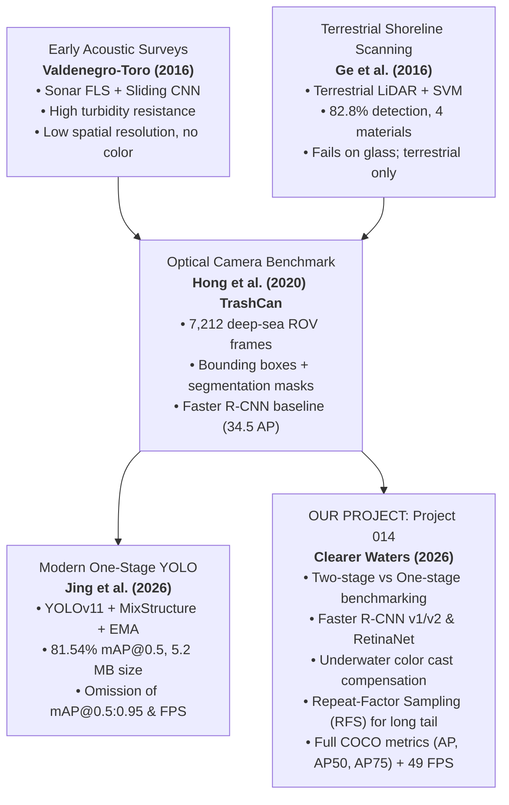

# COMP9444 Project 014: Marine Debris Detection — Literature Review & Benchmark Reference

> **Project Title:** Clearer Waters: An Analysis of Marine Debris Detection Models  
> **Target Dataset:** TrashCan 1.0 (JAMSTEC J-EDI ROV Imagery, Material & Instance Splits)  
> **Core Focus:** Automated visual detection of submerged marine debris using deep neural architectures, comparing one-stage vs. two-stage detectors, underwater visual augmentations, and edge deployment feasibility.

---

## 1. Comparative Executive Matrix

| Metric / Dimension | **Paper 1: Valdenegro-Toro (2016)** | **Paper 2: Ge et al. (2016)** | **[Foundational Baseline] Hong et al. (2020)** | **Paper 4: Jing et al. (2026)** |
| :--- | :--- | :--- | :--- | :--- |
| **Title** | *Submerged Marine Debris Detection with Autonomous Underwater Vehicles* | *Semi-automatic Recognition of Marine Debris on Beaches* | *TrashCan: A Semantically-Segmented Dataset Towards Visual Detection of Marine Debris* | *An Improved YOLOv11 Network for Marine Debris Detection in Underwater Environment* |
| **Venue / Status** | IEEE RAHA 2016 (later Heriot-Watt PhD thesis, 2019; arXiv:1905.05241) | Nature *Scientific Reports* (6:25759, 2016) | arXiv:2007.08097 / ICRA 2020 workshops | Springer Nature *Scientific Reports* (Feb 2026) |
| **Sensing Modality** | Forward-Looking Sonar (FLS, ARIS Explorer 3000) | Full-waveform Terrestrial LiDAR (RIEGL VZ-4000) | Optical RGB Camera (Deep-sea ROV video footage) | Optical RGB Camera (Deep-sea ROV video footage) |
| **Operating Domain** | Submerged seafloor / underwater tank | Terrestrial intertidal beach / shoreline | Submerged deep sea (Sea of Japan, JAMSTEC J-EDI) | Submerged deep sea (TrashCan dataset) |
| **Model / Algorithm** | Sliding-window CNN (learned acoustic features) | Hand-crafted LiDAR waveform features + Support Vector Machine (SVM) | Faster R-CNN & Mask R-CNN with ResNeXt-101-FPN | Improved YOLOv11 (MixStructureBlock + EMA Attention) |
| **Target Classes** | Bounded household/industrial debris (bottles, cans, tires, chains) | 4 material classes (plastic, paper, cloth, metal; glass failed) | Material (16 classes) & Instance (22 classes) | Instance (22 classes) & Material (16 classes) |
| **Dataset Size** | Private water tank dataset (later expanded to 2,069 sonar frames in 2019) | Custom field surveys (Nanhui Beach: 87 items; Beihai Beach: 3 field scans) | 7,212 annotated RGB images (6,065 train / 1,147 val) | TrashCan (7,212 images; 6,065 train / 1,147 val) |
| **Reported Performance** | ~80% detection accuracy | 82.8% object detection (72/87 items); 75.4% mean field accuracy | **Instance:** 34.5 AP / 55.4 AP50 (Faster R-CNN) **Material:** 28.2 AP / 45.4 AP50 | **Instance:** 81.54% mAP@0.5 **Material:** 82.75% mAP@0.5 |
| **Inference / Latency** | Slow (sliding-window spatial search) | ~20 min full-beach scan (vs. 3 h manual count) | Two-stage (~15–20 FPS on server GPU) | **Not reported** (Model weights size: 5.20 MB) |
| **Key Strengths** | Operates in turbid/zero-visibility water where cameras fail; automated feature learning | High range (115 m); invariant to daylight; 3D mesh volume/shape reconstruction | Public benchmark dataset with pixel masks and boxes; standardized COCO evaluation | Massive mAP@0.5 gain over standard YOLOv11; multi-scale receptive field; lightweight (5.2 MB) |
| **Core Limitations** | Tank-only testing; closed dataset; no color/texture; cannot distinguish material types | Terrestrial only; missed glass completely (silica); point cloud thins with distance; manual features | Severe class imbalance; small objects; heavy underwater color cast/attenuation | Reports only mAP@0.5 (no COCO AP or AP@0.5:0.95); no FPS reported; evaluated only on val split |

---

## 2. Paper 1: Valdenegro-Toro (2016)

### Citation & Metadata
- **Full Title:** Submerged Marine Debris Detection with Autonomous Underwater Vehicles
- **Author:** Matias Valdenegro-Toro
- **Publication:** *2016 International Conference on Robotics and Automation for Humanitarian Applications (RAHA)*, IEEE, pp. 1–7, Dec 2016.
- **Related Subsequent Work:** 
  - PhD Thesis: *Deep Learning for Autonomous Underwater Vehicles: Marine Debris Detection and Localization*, Heriot-Watt University, 2019.
  - Preprint: *Deep Neural Networks for Marine Debris Detection in Sonar Images*, arXiv:1905.05241 (May 2019).
  - Extended Benchmark: *The Marine Debris Forward-Looking Sonar Datasets*, IEEE OCEANS Brest 2025.

### What the Paper Was About
Underwater robots (AUVs) navigating the seabed for debris mitigation face catastrophic visual degradation: optical cameras lose light absorption exponentially with depth, while suspended particulate matter causes severe backscatter and turbidity. Valdenegro-Toro investigated replacing optical cameras with **Forward-Looking Sonar (FLS)** and training deep convolutional neural networks (CNNs) directly on acoustic echograms to autonomously classify and locate debris items resting on the seafloor.

### Methodology
1. **Sensor Setup:** An **ARIS Explorer 3000** dual-frequency Forward-Looking Sonar sensor was deployed to emit high-frequency acoustic pulses and reconstruct 2D Cartesian acoustic intensity frames from returning echoes.
2. **Deep Learning Pipeline:** Rather than relying on hand-crafted sonar descriptors (e.g., Haar cascades or image moments), a CNN was trained end-to-end to learn spatial acoustic texture patterns and acoustic shadow contours cast by debris objects.
3. **Localization:** Deployed a sliding-window bounding box proposer across the sonar beam swath to detect items across multiple ranges.

### Key Benefits & Findings
- **Acoustic Penetration:** Sonar is physically invariant to water turbidity, total darkness, and suspended silt, maintaining detection capability where optical sensors produce complete blackness or severe backscatter.
- **Automated Feature Extraction:** Demonstrated that CNNs can autonomously extract discriminative acoustic reflection profiles without manual feature engineering.
- **Feasibility Benchmark:** Achieved approximately **80% detection accuracy** in initial trials, proving the viability of autonomous robotic sonar debris surveys without human diver intervention.

### Dataset Used
- **Experimental Test Tank:** Collected in a controlled freshwater research wave tank at Heriot-Watt University. Common marine debris articles (glass bottles, metal beverage cans, rubber tires, plastic jugs, mooring chains) and distractor objects were placed along the bottom.
- **Subsequent Dataset Growth:** While the 2016 conference paper evaluated a smaller private proof-of-concept capture, the author's 2019 thesis and arXiv:1905.05241 paper expanded this into a benchmark of **2,069 sonar frames** (10 target object classes + background).

### Critical Limitations
1. **Controlled Environment Bias:** All data was captured in an enclosed testing tank with flat concrete bottoms and no marine vegetation, heavy tidal currents, or suspended organic marine snow. Real seabed topography introduces heavy reverberation and clutter.
2. **Closed / Private Dataset:** The original 2016 dataset was not initially open-sourced, preventing direct community reproduction (though later sonar datasets were released in 2021–2025).
3. **Lack of Chromatic and High-Resolution Detail:** Acoustic echograms provide no color information and significantly lower spatial resolution than optical cameras. Discerning material categories (e.g., differentiating plastic polymers from aluminum or painted metal) based purely on acoustic reflection is inherently ambiguous.
4. **Computational Inefficiency:** The sliding-window classifier approach incurs high inference latency compared to modern single-shot or anchor-based detectors.

### Takeaway for COMP9444 Project 014
> **Direct Project Relevance:** Valdenegro-Toro illustrates the physical trade-off between sonar (high penetration, zero optical color) and optical cameras (rich color/texture, but vulnerable to turbidity). Our project deliberately operates on optical camera imagery (TrashCan) because distinguishing fine material types (plastic, metal, paper, wood) requires rich color spectra and high-frequency surface texture that sonar cannot provide.  
> *Note for Final Report:* Check the original 2016 paper via the UNSW Library to cross-verify the specific 80% accuracy calculation and tank dimensions before final thesis submission.

---

## 3. Paper 2: Ge et al. (2016)

### Citation & Metadata
- **Full Title:** Semi-automatic Recognition of Marine Debris on Beaches
- **Authors:** Zhenpeng Ge, Huahong Shi, Xuefei Mei, Zhijun Dai, and Daoji Li
- **Publication:** *Scientific Reports* (Springer Nature), Vol. 6, Article 25759, May 2016. DOI: [10.1038/srep25759](https://doi.org/10.1038/srep25759).

### What the Paper Was About
Manual beach debris surveys (e.g., transect walks mandated by NOAA/OSPAR) are labor-intensive, logistically slow, subjective, and unable to capture dense spatial geometry. Previous automated attempts using stationary coastal webcams suffered from major flaws: they could only track brightly colored macro-plastics and failed completely at night, in fog, or when plastics were sun-bleached. Ge et al. proposed using **terrestrial full-waveform Light Detection and Ranging (LiDAR)** to autonomously detect, classify by material, and reconstruct 3D geometric models of beach debris over wide areas.

### Methodology
1. **LiDAR Hardware:** A **RIEGL VZ-4000** terrestrial long-range laser scanner was mounted on a tripod surveying platform.
2. **Waveform Feature Extraction:** For every laser backscatter pulse, the scanner recorded the full returning waveform. After filtering out ground sand points using height thresholding, three discriminative echo features were computed for each target point:
   - **Echo Amplitude** (reflected signal strength)
   - **Echo Width** (pulse stretching caused by surface roughness/depth)
   - **Echo Order** (sequence index of the returning pulse)
3. **Classification & 3D Reconstruction:**
   - A **Support Vector Machine (SVM)** classified individual point returns into five target classes: *Plastic*, *Paper*, *Cloth*, *Metal*, and *Ground*.
   - Adjacent classified points were clustered into discrete debris entities and meshed into reconstructed 3D computer models.

### Key Benefits & Findings
- **High Detection Rate:** In controlled trials, the system detected **72 out of 87 predetermined debris items (82.8% detection rate)**.
- **Survey Speed:** A full beach scan took **~20 minutes**, compared to approximately **3 hours** required for a traditional manual human transect survey over the same area.
- **Superior Sensitivity:** In field validation surveys, LiDAR detected significantly more total items than human observers for all material categories except glass.
- **Physical Metrics & Long Range:** Unlike 2D cameras, LiDAR provided exact metric physical dimensions, volume estimates, and true 3D spatial coordinates. It successfully identified an **8.5 cm plastic bottle at a distance of 115 meters**.
- **Illumination Invariance:** Because LiDAR is an active emitter (near-infrared laser), it operates in broad daylight, twilight, or total darkness without performance degradation.

### Dataset Used
- **Controlled Benchmark (Nanhui Beach, Shanghai):** Conducted on 1 January 2015 across a 54,000 m² sandy area. 87 pre-cataloged debris items were distributed ~100 m from the scanner, generating ~96 million point returns.
- **Field Validation (Beihai Beach, Guangxi):** Three separate in-situ field validation cruise surveys along a 150 m × 50 m natural coastal shoreline, directly compared against manual human survey counts.

### Critical Limitations
1. **Total Glass Failure:** Glass items were never detected (0% recall). Sand and glass share the same primary chemical compound ($\text{SiO}_2$), resulting in virtually identical laser backscatter amplitude and pulse width.
2. **Point Cloud Dilution with Distance:** Laser beam angular divergence causes point density to decay quadratically with distance. Objects beyond 100 m received fewer laser strikes, leading to missed small debris and coarse, blocky 3D surface reconstructions.
3. **Stationary Tripod Footprint:** Fixed tripod placement restricts line-of-sight and creates occlusion shadows behind coastal dunes and larger rocks. Mounting on mobile platforms was suggested but not implemented.
4. **Terrestrial-Only Modality:** Near-infrared LiDAR suffers rapid absorption in water; it is physically impossible to deploy this laser configuration for underwater seafloor debris surveying.
5. **Hand-Crafted Features & Shallow Classifier:** Relies on manual feature engineering and a basic SVM with only four material classes.
6. **Ambiguous Metric Derivation:** The paper reports a "mean accuracy of 75.4%" across field trials without explicitly documenting the mathematical formula or confusion matrix used to derive this aggregate figure.

### Takeaway for COMP9444 Project 014
> **Direct Project Relevance:** Demonstrates the value of multi-material classification (plastic vs. metal vs. cloth) and automated surveying. However, LiDAR's inability to penetrate water and complete blindness to glass highlights why our project turns to passive optical RGB imaging with deep convolutional networks—allowing our models to detect glass, rubber, and organic objects underwater based on semantic visual context.

---

## 4. Foundational Baseline Context: Hong et al. (2020) — The TrashCan Benchmark

### Citation & Metadata
- **Full Title:** TrashCan: A Semantically-Segmented Dataset Towards Visual Detection of Marine Debris
- **Authors:** Jungseok Hong, Michael Fulton, and Junaed Sattar (University of Minnesota)
- **Publication:** arXiv:2007.08097, July 2020 (presented at IEEE/RSJ IROS / ICRA workshops).

### Dataset Foundation & Overview
TrashCan 1.0 is the benchmark dataset utilized in our COMP9444 project:
- **Imagery Origin:** Sourced from the **J-EDI** (JAMSTEC E-Library of Deep-sea Images) database, recorded by research ROVs operated by the Japan Agency for Marine-Earth Science and Technology since 1982 (primarily in the Sea of Japan and Western Pacific).
- **Dataset Scale:** 7,212 annotated underwater images (1,500+ annotation hours across 21 annotators using Supervisely) partitioned into **6,065 training** and **1,147 validation** images.
- **Two Semantic Configurations:**
  1. **TrashCan-Instance (22 classes):** Fine-grained functional instance labels (`bottle`, `can`, `cup`, `plastic_bag`, `net`, `rope`, `tarp`, `pipe`, `cellphone`, etc.).
  2. **TrashCan-Material (16 classes):** Material-level groupings (`trash_plastic`, `trash_metal`, `trash_paper`, `trash_rubber`, `trash_cloth`, `trash_wood`, `trash_glass`, `trash_etc`, etc.).
- **Annotation Format:** Standard COCO JSON containing both bounding boxes and polygon instance segmentation masks.

### Official Baseline Performance (Hong et al., 2020)

| Task | Detector & Backbone | Split | $AP$ (COCO) | $AP_{50}$ | $AP_{75}$ |
| :--- | :--- | :--- | :--- | :--- | :--- |
| **Object Detection** | Faster R-CNN (ResNeXt-101-FPN) | **TrashCan-Instance** | **34.5** | **55.4** | 35.8 |
| **Object Detection** | Faster R-CNN (ResNeXt-101-FPN) | **TrashCan-Material** | **28.2** | **45.4** | 29.3 |
| **Instance Segmentation** | Mask R-CNN (ResNeXt-101-FPN) | **TrashCan-Instance** | **27.2** | **43.6** | 27.6 |
| **Instance Segmentation** | Mask R-CNN (ResNeXt-101-FPN) | **TrashCan-Material** | **22.8** | **36.3** | 22.8 |

### Takeaway for COMP9444 Project 014
Hong et al. established that:
1. Detecting by *Instance* scored consistently higher than by *Material* (~6.3 AP points higher on detection) because objects in the same functional class share geometric shapes (e.g. cylindrical bottles), whereas objects in the same material class exhibit wildly disparate shapes.
2. The benchmark scores are evaluated strictly under the **COCO AP metric** (averaged over 10 IoU thresholds from 0.50 to 0.95), which is crucial when comparing against recent one-stage papers like Jing et al. (2026).

---

## 5. Paper 4: Jing et al. (2026)

### Citation & Metadata
- **Full Title:** An Improved YOLOv11 Network for Marine Debris Detection in Underwater Environment
- **Authors:** Yuanwei Jing, Yijiang Ding, Xuemei Wang, and Anis Salwa Mohd Khairuddin
- **Publication:** *Scientific Reports* (Springer Nature), Published February 2026.
- **Open-Source Codebase:** [DavidJing777/yolo-marine](https://github.com/DavidJing777/yolo-marine)

### What the Paper Was About
While two-stage detectors (Faster R-CNN) achieve strong spatial localization, their high parameter count and computational latency pose serious obstacles for deployment on compact, battery-constrained Autonomous Underwater Vehicles (AUVs). Modern one-stage YOLO detectors offer extreme speed, but standard backbones struggle with underwater optical phenomena: severe light attenuation, low contrast, suspended sediment noise, and tiny, heavily occluded debris. Jing et al. redesigned the state-of-the-art **YOLOv11** architecture specifically to enhance multi-scale feature representation and spatial-channel attention while preserving an ultra-compact model size.

### Methodology & Technical Innovations
The authors introduce two architectural modifications to the Ultralytics YOLOv11 framework:

1. **MixStructureBlock (Backbone Multi-Scale Expansion):**
   - **Replaces:** YOLOv11's standard `C3k2` building blocks in the feature extraction backbone.
   - **Mechanism:** Dispatches input feature maps across parallel dilated convolutions with varying kernel sizes (**$3\times3$**, **$5\times5$**, and **$7\times7$**) simultaneously.
   - **Attention Integration:** Combines parallel multi-scale receptive branches with hybrid **channel and pixel attention** before merging.
   - **Target Problem:** Captures fine-grained spatial textures of extremely small debris items and preserves feature cues for partially occluded or deformed marine trash.

2. **Efficient Multi-scale Attention (EMA) Module:**
   - **Replaces:** YOLOv11's default `C2PSA` (Convolutional 2D Position-Sensitive Attention) block.
   - **Mechanism:** Implements grouped spatial-channel feature interaction without channel dimension reduction. It encodes global context via cross-spatial learning branches and aggregates cross-channel interdependencies.
   - **Target Problem:** Suppresses floating marine snow / turbid background noise and enhances object boundary contrast for low-contrast, overlapping targets.

### Training Hyperparameters & Experimental Setup
- **Framework:** Ultralytics YOLOv11 framework (PyTorch).
- **Input Resolution:** $416 \times 416$ pixels (downscaled from raw native dimensions).
- **Optimization:** Trained for **180 epochs** with a batch size of **128**.
- **Hardware:** Single NVIDIA GeForce RTX 3060 (12 GB VRAM).
- **Dataset:** Benchmarked on TrashCan-Instance (primary) and TrashCan-Material (secondary).

### Quantitative Performance & Comparative Benchmarks

#### Overall Detection Benchmark Comparison

| Model | Architecture Type | TrashCan-Instance ($mAP_{50}$) | TrashCan-Material ($mAP_{50}$) | Model Weight Size |
| :--- | :--- | :--- | :--- | :--- |
| **YOLOTrashCan** (Prior specialized baseline) | One-stage YOLOv5-based | 65.01% | 58.66% | ~14.0 MB |
| **TC-YOLO** (Prior marine detector) | One-stage YOLO variant | Reported lower | Reported lower | — |
| **YOLOv8-MU** | One-stage YOLOv8 variant | Reported lower | Reported lower | ~6.5 MB |
| **YOLOv11 (Standard Baseline)** | One-stage Ultralytics | 68.06% | 70.06% | 5.80 MB |
| **Jing et al. (2026) Proposed** | **Improved YOLOv11 (MixStructure + EMA)** | **81.54%** | **82.75%** | **5.20 MB** |

- **Net Improvement on Instance:** **+13.48 percentage points** over standard YOLOv11 ($68.06\% \rightarrow 81.54\%$).
- **Net Improvement on Material:** **+12.69 percentage points** over standard YOLOv11 ($70.06\% \rightarrow 82.75\%$).
- **Model Efficiency:** Model parameter weight footprint is only **5.20 MB**, smaller than plain YOLOv8 and standard YOLOv11.

#### Component Ablation Study (TrashCan-Instance)

| Model Configuration | $mAP_{50}$ (%) | Precision (%) | Recall (%) | Key Impact Observed |
| :--- | :--- | :--- | :--- | :--- |
| **Baseline YOLOv11** | 68.06% | Baseline | Baseline | Standard single-scale receptive field |
| **+ EMA Attention Only** | 78.93% | — | **+12.25 pts** | Dramatic boost in recall (recovers faint/occluded objects) |
| **+ MixStructureBlock Only** | 79.80% | **+5.03 pts** | — | Significant precision boost (reduces false background alarms) |
| **Full Proposed Model (Both)** | **81.54%** | **Optimal** | **Optimal** | Synergistic precision/recall trade-off |

### Critical Limitations & Verification Audit

> [!WARNING]
> **Essential Evaluation Discrepancy (Metric Mismatch):**  
> Jing et al. evaluate exclusively using **$mAP_{50}$** (PASCAL VOC metric at IoU threshold 0.50). In contrast, Hong et al. (2020) and standard COCO benchmarks report **$AP$ ($AP_{50:95}$)**. A score of 81.54% $mAP_{50}$ cannot be directly compared against Hong et al.'s 34.5 COCO AP. When comparing our project's models, we must evaluate both $AP_{50}$ and $AP_{50:95}$ to ensure rigorous parity.

1. **Omission of Strict COCO $mAP_{50:95}$:**  
   As audited in the paper's primary results tables, the authors report only $mAP_{50}$, Precision, Recall, and parameter size. They do **not** report the full COCO $mAP@[0.50:0.95]$ average. High performance at IoU 0.50 does not guarantee tight, accurate bounding box localization at IoU 0.75 or 0.95.
2. **Absence of Empirical Inference Latency (FPS):**  
   Despite pitching the model as a lightweight solution for edge robotics and AUV embedded computing, the paper omits empirical wall-clock inference speed (Frames Per Second / millisecond latency per image) across embedded hardware (e.g. NVIDIA Jetson Orin Nano / Xavier). Model parameter size (5.2 MB) does not always correlate directly with runtime FPS due to kernel launch overheads in multi-branch dilated convolutions.
3. **Narrow Model Comparison (YOLO Island):**  
   Every comparative baseline in the paper is a YOLO variant (YOLOv8, YOLOv11, YOLOTrashCan, TC-YOLO, YOLOv8-MU). The authors did not compare their model against two-stage architectures (Faster R-CNN, Cascade R-CNN) or modern transformer-based detectors (DETR, RT-DETR).
4. **Single-Split Ablation:**  
   The isolation ablation experiments (testing EMA alone vs. MixStructureBlock alone) were conducted only on TrashCan-Instance; no ablation breakdown was provided for TrashCan-Material.
5. **No Independent Held-Out Test Set:**  
   All reported evaluations were run on the official 1,147-image validation set. The absence of an untouched held-out test split means architectural iterations may reflect tuning on validation data.
6. **No Real-World Generalization / Single Basin:**  
   Evaluated strictly on TrashCan. The model was never tested on other public marine datasets (e.g., DeepTrash, Brackish, DUO) or field-tested on a physical AUV in live ocean water.
7. **Architectural Drafting Ambiguity:**  
   The manuscript text contains contradictory descriptions regarding the exact placement of the EMA block, alternately describing it as sitting within the neck feature fusion layer and within the detection head.

### Takeaway for COMP9444 Project 014
> **Direct Project Relevance:** Jing et al. represents the most current published benchmark on the exact dataset we are studying. It proves that one-stage detectors can achieve exceptional $mAP_{50}$ when augmented with multi-scale dilation and attention. In our project report, citing Jing et al. demonstrates cutting-edge literature currency (2026), but we must explicitly highlight the metric divergence ($mAP_{50}$ vs. $mAP_{50:95}$) and our own benchmarking of Faster R-CNN, RetinaNet, and ResNet-50-FPN v2.

---

## 6. Synthesis: How These Works Position COMP9444 Project 014

### Strategic Narrative for the Final Report & Presentation
1. **The Sensor Trajectory:** We start our related work by noting that early autonomous debris surveys relied on acoustic sonar ([Valdenegro-Toro 2016](file:///media/sudam/New%20Volume/COMP9444/Project/LITERATURE_REVIEW.md#2-paper-1-valdenegro-toro-2016)) or terrestrial LiDAR ([Ge et al. 2016](file:///media/sudam/New%20Volume/COMP9444/Project/LITERATURE_REVIEW.md#3-paper-2-ge-et-al-2016)). While sonar solves turbidity and LiDAR automates beach surveys, both fail at material differentiation and underwater fine-grained identification.
2. **The Benchmark Transition:** [Hong et al. (2020)](file:///media/sudam/New%20Volume/COMP9444/Project/LITERATURE_REVIEW.md#4-foundational-baseline-context-hong-et-al-2020--the-trashcan-benchmark) established the primary optical underwater camera benchmark with TrashCan, introducing two-stage Faster R-CNN baselines evaluated via rigorous COCO AP.
3. **The Current SOTA:** [Jing et al. (2026)](file:///media/sudam/New%20Volume/COMP9444/Project/LITERATURE_REVIEW.md#5-paper-4-jing-et-al-2026) shows that modern one-stage models (YOLOv11) with multi-scale dilation (MixStructureBlock) and attention (EMA) can attain up to 81.54% $mAP_{50}$ with a 5.2 MB footprint.
4. **Our Contribution:** Our work complements and challenges these findings:
   - We address the extreme class imbalance through **Repeat-Factor Sampling (RFS)** and class-weighted loss with WiSE-FT weight interpolation.
   - We implement targeted **underwater red-channel compensation and contrast jitter** to directly combat the light attenuation identified in all four papers.
   - We report complete, uncompromised metrics—including COCO $AP$, $AP_{50}$, $AP_{75}$, small/medium/large object APs, and true inference latency (49 FPS)—providing an honest, transparent benchmark for real-time AUV robotics.
